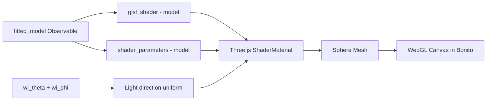

# Interactive App: Renderings, Controls & Layout Plan

## Phased Approach

### Phase 1: UI Restructuring (implement now)
- Two-column upper layout: Load BRDF (left) + Fit Model (right)
- Visibility toggle controls: ☑ Scatter ☑ Surface ☑ Render
- Placeholder render panels in visualization grid

### Phase 2: Three.js Fitted Model Rendering (implement next)
- Three.js sphere rendering using existing GLSL shaders from `src/rendering/shaders/`
- Only for fitted models (each model already has `glsl_shader()` + `shader_parameters()`)
- Uses `Bonito.ES6Module` for Three.js and `Bonito.onload` for setup

### Phase 3: Measured BRDF Rendering (deferred)
- Waiting for user to provide MERL GLSL shader
- Will use same Three.js infrastructure from Phase 2

---

## Phase 1: Detailed Changes to `src/app/interactive_app.jl`

### 1A. Two-Column Upper Layout

**Current (lines 459-498):** Two separate `DOM.div` blocks stacked vertically:
- Load BRDF block (lines 459-478)
- Fit Model block (lines 480-498)

**New:** Single flex row with two columns:

```
┌──────────────────────────┬──────────────────────────┐
│ 📂 Load BRDF             │ 🎯 Fit Model             │
│ [file input]             │ Model: [select]           │
│ .binary / .bird / .json  │ Optimizer: [select]      │
│ Or path: [input] [Load]  │ [🎯 Fit]  status-badge   │
│ upload_indicator         │ Parameters: ...           │
│ status_display           │                           │
└──────────────────────────┴──────────────────────────┘
```

Implementation: Wrap both in a `DOM.div(style="display: flex; gap: 10px; margin-bottom: 10px;")` with each child having `flex: 1`.

### 1B. Visibility Toggle Controls

Add to the existing Plot Controls block (lines 500-578), as a new row:

```
Row 3: Visibility: ☑ Scatter  ☑ Surface  ☑ Render
```

Three new `Observable{Bool}` observables:
- `show_scatter_obs` (default: true)
- `show_surface_obs` (default: true)  
- `show_render_obs` (default: true)

Each viz panel wrapped in `map(show_xxx_obs)` that returns content or hidden div.

### 1C. Visualization Grid with Placeholder Render

Expand from 2×2 to 2×3:

```
Measured:  [Scatter] [Surface] [Render - placeholder]
Fitted:    [Scatter] [Surface] [Render - placeholder]
```

Render placeholders show "Rendering will appear here when a model is fitted" or similar.

---

## Phase 2: Three.js Rendering (fitted models only)

### Architecture



### Implementation approach

1. Define `const THREE = ES6Module(...)` at module level
2. Create a `DOM.div` container for each render (measured + fitted)
3. Use `Bonito.onload(session, container, js"...")` to initialize Three.js scene
4. When `fitted_model` changes, send GLSL code + parameters to JS via observables
5. JS side: create `THREE.ShaderMaterial` with the BRDF fragment shader
6. Vertex shader: standard transformation + pass normal/position to fragment
7. Fragment shader: call `brdf_evaluate(light_dir, view_dir, normal)` from the model's GLSL
8. Add orbit controls for camera rotation

### GLSL Integration

Each model's `glsl_shader()` returns `(code, dependencies)`. The `code` contains a `brdf_evaluate(wi, wo, N)` function. We wrap it in a full fragment shader:

```glsl
// Vertex shader
varying vec3 vNormal;
varying vec3 vPosition;
void main() {
    vNormal = normalize(normalMatrix * normal);
    vPosition = (modelViewMatrix * vec4(position, 1.0)).xyz;
    gl_Position = projectionMatrix * modelViewMatrix * vec4(position, 1.0);
}

// Fragment shader
uniform vec3 u_lightDir;  // from wi_theta, wi_phi
uniform vec3 u_viewDir;   // camera direction
// ... model-specific uniforms from shader_parameters() ...
// ... brdf_evaluate() from glsl_shader() ...

void main() {
    vec3 N = normalize(vNormal);
    vec3 wi = normalize(u_lightDir);
    vec3 wo = normalize(u_viewDir - vPosition);
    vec3 color = brdf_evaluate(wi, wo, N);
    // Tone mapping
    color = color / (color + vec3(1.0));  // Reinhard
    gl_FragColor = vec4(color, 1.0);
}
```

---

## Files to Modify

| Phase | File | Changes |
|-------|------|---------|
| 1 | `src/app/interactive_app.jl` | Two-column layout, visibility toggles, placeholder render panels |
| 2 | `src/app/interactive_app.jl` | Three.js integration for fitted model sphere rendering |
| 2 | `src/rendering/` | Possibly a new helper module for Three.js scene setup |
