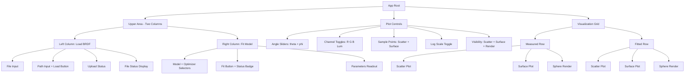
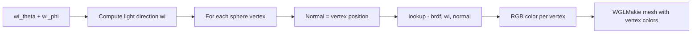

# Interactive App: Renderings, Controls & Layout Plan

## Summary of Changes

Three major improvements to the interactive BRDF app:
1. **Add sphere renderings** for both measured and fitted BRDFs
2. **Add visibility toggles** for scatter, surface, and render views
3. **Restructure upper layout** into two columns (Load BRDF + Fit Model side by side)

---

## Current State

The app (`src/app/interactive_app.jl`) has:
- **Load BRDF** section (file upload + path input)
- **Fit Model** section (model/optimizer selectors + fit button)
- **Plot Controls** section (angle sliders, channel toggles, sample points, log scale)
- **2×2 visualization grid**: Measured Scatter | Measured Surface | Fitted Scatter | Fitted Surface

No sphere rendering is implemented. GLSL shaders exist in `src/rendering/shaders/` but are unused in the app.

---

## Detailed Plan

### 1. Add `SphereRenderHandle` to `src/visualization/plots.jl`

Create a new plot handle similar to `SurfacePlotHandle` that renders a **UV sphere** colored by BRDF evaluation under a given light direction.

**New struct:**
```julia
struct SphereRenderHandle
    ax::Axis3
    mesh_vertices::Observable{Vector{Point3f}}
    mesh_colors::Observable{Vector{RGBf}}
    mesh_faces::Observable{Vector{TriangleFace{Int}}}
    n_segments::Observable{Int}     # longitudinal segments
    visible::Observable{Bool}
end
```

**New functions:**
- `setup_sphere_render!(fig_position; n_segments=64)` — Creates a UV sphere mesh (radius 1), initializes with gray, returns handle
- `update_sphere_render!(handle, brdf, wi_theta, wi_phi)` — Evaluates BRDF at each vertex for light from `(wi_theta, wi_phi)`, sets vertex colors to the resulting RGB values
- `clear_sphere_render!(handle)` — Resets to gray sphere

**Sphere rendering approach:**
- Generate a UV sphere with `n_segments` longitude bands and `n_segments/2` latitude bands
- For each vertex, compute its normal (= position for unit sphere)
- Evaluate `lookup(brdf, wi, normal_as_wo)` treating each vertex normal as the outgoing direction
- Use the resulting RGB as vertex color
- This creates a "lit sphere" preview showing how the material looks under a single light

**Why WGLMakie instead of Three.js:**
- Consistent with existing codebase (scatter + surface already use WGLMakie)
- No additional JS dependencies needed
- Works for both measured and fitted BRDFs via the universal `lookup()` interface
- The existing `_AnalyticalWrapper` adapter in `interactive_app.jl` already makes fitted models compatible

### 2. Add Sphere Renders to `interactive_app.jl`

Add two new figure/render handle pairs (following the existing pattern):

```julia
# Measured sphere render
fig_render = Figure(resolution=(700, 700))
render_handle = setup_sphere_render!(fig_render[1, 1]; n_segments=64)

# Fitted sphere render
fig_render_fit = Figure(resolution=(700, 700))
render_handle_fit = setup_sphere_render!(fig_render_fit[1, 1]; n_segments=64)
```

Wire them into the existing `_wire_plots!` reactive system (extend or create `_wire_renders!`).

### 3. Add Visibility Toggle Controls

Add three checkboxes to the Plot Controls section:

```
☑ Scatter  ☑ Surface  ☑ Render
```

Each toggle shows/hides the corresponding visualization panels. Implementation:
- Create `Observable{Bool}` for each: `show_scatter`, `show_surface`, `show_render`
- Wrap each visualization `DOM.div` in a `map(show_xxx)` that returns either the content or an empty hidden div
- This is purely a DOM-level toggle — no re-computation needed

### 4. Restructure Upper Layout

Change from vertical stacking to a two-column layout:

```
BEFORE (vertical):                AFTER (two columns):
┌─────────────────────────┐      ┌──────────────────┬──────────────────┐
│ Load BRDF               │      │ Load BRDF        │ Fit Model        │
│ [file input]            │      │ [file input]     │ Model: [select]  │
│ [path input] [Load]     │      │ [path] [Load]    │ Opt:   [select]  │
│ status...               │      │ status...        │ [Fit] status     │
├─────────────────────────┤      │                  │ Parameters: ...  │
│ Fit Model               │      └──────────────────┴──────────────────┘
│ Model: [select]         │      ┌──────────────────────────────────────┐
│ Opt:   [select]         │      │ Plot Controls                       │
│ [Fit] status            │      │ θ [slider] φ [slider]               │
│ Parameters: ...         │      │ Channels: R G B Lum | Pts | Log     │
├─────────────────────────┤      │ Visibility: ☑ Scatter ☑ Surface ☑ Render │
│ Plot Controls           │      └──────────────────────────────────────┘
│ θ [slider] φ [slider]   │
│ Channels | Pts | Log    │
└─────────────────────────┘
```

Implementation: Use `display: flex` with two child `div`s, each `flex: 1`.

### 5. Update Visualization Grid

Expand from 2×2 to 2×3 (or 3×2) to include renderings:

```
Measured:  [Scatter] [Surface] [Sphere Render]
Fitted:    [Scatter] [Surface] [Sphere Render]
```

Each row uses `display: flex` with three equal-width panels. Visibility toggles hide individual panels.

---

## Files to Modify

| File | Changes |
|------|---------|
| `src/visualization/plots.jl` | Add `SphereRenderHandle`, `setup_sphere_render!`, `update_sphere_render!`, `clear_sphere_render!`, helper functions, exports |
| `src/app/interactive_app.jl` | Add render handles, wire reactive plots, add visibility toggles, restructure layout to two-column upper area, expand visualization grid |

---

## Mermaid: Updated App Layout



## Mermaid: Sphere Rendering Data Flow


